# Schema ER

Schema del database di Casa del Silicio: tabelle di Laravel usate dal progetto, tabelle del negozio e tabelle della sicurezza dell'account.

Fonti:
- skill `ecommerce-domain`, `account-security`, `laravel-api`, `testing`, `react-architecture`, `mui-design-system`
- migration già committate in `backend/database/migrations/` (`users`, `password_reset_tokens`, `sessions`, `cache`, `cache_locks`, `jobs`, `job_batches`, `failed_jobs`)
- `docs/backlog.md`

Convenzioni del documento:
- I tipi sono i metodi di `Blueprint` usati nelle migration (`unsignedInteger`, `string(64)`, `json`…). `id` è `bigIncrements`, `foreignId` è `unsignedBigInteger`.
- "Nullable" vale **no** se non indicato diversamente; "—" nella colonna Default significa nessun default.
- `created_at` e `updated_at` creati da `timestamps()` sono nullable in tutte le tabelle, anche dove il diagramma non lo indica.
- Lo schema descrive lo stato finale. Le tabelle annotate come provvisorie o con una fase (es. `passkeys`, Fase 3c) sono previste e non ancora migrate.
- Le tabelle e le colonne che non esistono ancora nascono da **nuove** migration: quelle già committate non si modificano (CLAUDE.md, "Modo di lavorare").
- Fino alla Fase 2 (migration e modelli) questo documento si allinea alle skill; dalla Fase 2 la fonte sono le migration, e il documento si aggiorna nello stesso task di ogni migration che cambia il database.

## Diagramma

```mermaid
erDiagram
    users {
        bigint id PK
        string name
        string email UK
        timestamp email_verified_at "nullable"
        string password
        string role "customer | admin"
        timestamp password_changed_at "nullable"
        text two_factor_secret "nullable, encrypted"
        text two_factor_recovery_codes "nullable, encrypted:array, bcrypt"
        timestamp two_factor_confirmed_at "nullable"
        bigint two_factor_last_used_step "nullable"
        timestamp anonymized_at "nullable"
        string remember_token "nullable"
        timestamp created_at
        timestamp updated_at
    }

    password_reset_tokens {
        string email PK
        string token "hash"
        timestamp created_at "nullable"
    }

    sessions {
        string id PK
        bigint user_id "nullable, senza FK"
        string ip_address "nullable"
        text user_agent "nullable"
        longtext payload
        int last_activity
    }

    cache {
        string key PK
        mediumtext value
        bigint expiration
    }

    cache_locks {
        string key PK
        string owner
        bigint expiration
    }

    jobs {
        bigint id PK
        string queue
        longtext payload
        smallint attempts
        int reserved_at "nullable"
        int available_at
        int created_at
    }

    job_batches {
        string id PK
        string name
        int total_jobs
        int pending_jobs
        int failed_jobs
        longtext failed_job_ids
        mediumtext options "nullable"
        int cancelled_at "nullable"
        int created_at
        int finished_at "nullable"
    }

    failed_jobs {
        bigint id PK
        string uuid UK
        string connection
        string queue
        longtext payload
        longtext exception
        timestamp failed_at
    }

    addresses {
        bigint id PK
        bigint user_id FK
        string full_name
        string street
        string city
        char postal_code
        char province
        char country "sempre IT"
        string phone
        boolean is_default
        timestamp created_at
        timestamp updated_at
    }

    categories {
        bigint id PK
        string name UK
        string slug UK
        string description "nullable"
        timestamp created_at
        timestamp updated_at
    }

    products {
        bigint id PK
        bigint category_id FK
        string name
        string slug UK
        string sku UK
        string short_description
        text description "nullable"
        json specifications
        int price "centesimi"
        int stock
        boolean is_active
        timestamp created_at
        timestamp updated_at
        timestamp deleted_at "nullable, soft delete"
    }

    product_images {
        bigint id PK
        bigint product_id FK
        string path
        string alt
        smallint position
        timestamp created_at
        timestamp updated_at
    }

    carts {
        bigint id PK
        bigint user_id FK, UK
        timestamp created_at
        timestamp updated_at
    }

    cart_items {
        bigint id PK
        bigint cart_id FK
        bigint product_id FK
        smallint quantity
        timestamp created_at
        timestamp updated_at
    }

    orders {
        bigint id PK
        bigint user_id FK
        string number UK "nullable, scritto subito dopo l'insert"
        string status
        bigint subtotal "centesimi"
        int shipping_cost "centesimi"
        bigint total "centesimi"
        json shipping_address "snapshot"
        timestamp terms_accepted_at
        timestamp paid_at "nullable"
        timestamp shipped_at "nullable"
        timestamp delivered_at "nullable"
        timestamp cancelled_at "nullable"
        timestamp created_at
        timestamp updated_at
    }

    order_items {
        bigint id PK
        bigint order_id FK
        bigint product_id FK "nullable"
        string product_name "snapshot"
        string product_sku "snapshot"
        int unit_price "snapshot, centesimi"
        smallint quantity
        bigint line_total "centesimi"
        timestamp created_at
        timestamp updated_at
    }

    order_status_changes {
        bigint id PK
        bigint order_id FK
        string from_status "nullable"
        string to_status
        bigint changed_by FK "nullable = sistema"
        string reason "nullable"
        timestamp created_at
    }

    payments {
        bigint id PK
        bigint order_id FK
        string provider
        string provider_reference "nullable"
        bigint amount "centesimi"
        string status "succeeded | failed | refunded"
        char card_last_four
        timestamp created_at
        timestamp updated_at
    }

    email_change_requests {
        bigint id PK
        bigint user_id FK
        string new_email
        char token_hash UK
        char cancel_token_hash UK
        timestamp expires_at
        timestamp confirmed_at "nullable"
        timestamp cancelled_at "nullable"
        timestamp created_at
        timestamp updated_at
    }

    security_events {
        bigint id PK
        bigint user_id FK
        string type
        string ip_address "nullable"
        text user_agent "nullable, grezzo"
        json metadata "nullable"
        timestamp created_at
    }

    passkeys {
        bigint id PK "PROVVISORIA"
        bigint user_id FK
        string name
        text credential_id
        json data "chiave pubblica e contatore"
        timestamp last_used_at "nullable"
        timestamp created_at
        timestamp updated_at
    }

    users ||--o{ addresses : "ha"
    users ||--o| carts : "possiede"
    carts ||--o{ cart_items : "contiene"
    products ||--o{ cart_items : "è in"
    categories ||--o{ products : "raggruppa"
    products ||--o{ product_images : "ha"
    users ||--o{ orders : "effettua"
    orders ||--|{ order_items : "contiene"
    products |o--o{ order_items : "origine dello snapshot"
    orders ||--|{ order_status_changes : "cronologia"
    users |o--o{ order_status_changes : "changed_by"
    orders ||--o{ payments : "addebiti"
    users ||--o{ email_change_requests : "richiede"
    users ||--o{ security_events : "registra"
    users ||--o{ passkeys : "registra"
    users |o..o{ sessions : "user_id senza FK"
    users ||..o| password_reset_tokens : "email senza FK"
```

La tabella `passkeys` è **provvisoria**: la sua forma dipende dalla libreria WebAuthn, non ancora scelta (decisione D7).

## Tabelle di Laravel

### users

Account di clienti e amministratori, con i dati della doppia autenticazione. Le colonne `id`…`updated_at` di Laravel sono nella migration committata; `role`, `password_changed_at` e le quattro colonne `two_factor_*` arrivano da una **nuova** migration unica (D8); `anonymized_at` da un'altra nuova migration della Fase 3b, `2026_10_01_000001_add_anonymized_at_to_users_table` (D13).

| Colonna | Tipo | Nullable | Default | Chiave | Note |
|---|---|---|---|---|---|
| id | `id` | no | — | PK | |
| name | `string` | no | — | | nome e cognome |
| email | `string` | no | — | UK | |
| email_verified_at | `timestamp` | sì | null | | null = email da confermare |
| password | `string` | no | — | | hash |
| role | `string(20)` | no | `customer` | | cast a `UserRole` (`customer`, `admin`); la registrazione crea solo `customer` |
| password_changed_at | `timestamp` | sì | null | | nullable solo nel database (colonna aggiunta a una tabella esistente); registrazione, cambio e reset la valorizzano sempre, e così `UserFactory` |
| two_factor_secret | `text` | sì | null | | cast `encrypted`, in `$hidden`; esiste già prima della conferma del TOTP |
| two_factor_recovery_codes | `text` | sì | null | | hash bcrypt dei codici (D12), cast `encrypted:array`, in `$hidden`; null senza TOTP |
| two_factor_confirmed_at | `timestamp` | sì | null | | non null = doppia autenticazione attiva |
| two_factor_last_used_step | `unsignedBigInteger` | sì | null | | ultimo intervallo TOTP usato, impedisce il riutilizzo del codice |
| anonymized_at | `timestamp` | sì | null | | non null = account eliminato e anonimizzato (D13); cast `datetime`, non fillable: la valorizza solo `DeleteAccountAction`; senza indice, perché nessun filtro la usa |
| remember_token | `rememberToken` | sì | null | | di Laravel |
| created_at, updated_at | `timestamps` | sì | null | | |

- Indici e unicità: unico su `email`.
- Cancellazione: il progetto non elimina utenti, li anonimizza quando il cliente elimina l'account (D13); le FK verso `users` sono comunque scelte per ogni tabella (N1).

### password_reset_tokens

Token del password broker di Laravel per il recupero della password. Migration committata.

| Colonna | Tipo | Nullable | Default | Chiave | Note |
|---|---|---|---|---|---|
| email | `string` | no | — | PK | collegamento logico a `users.email`, senza FK |
| token | `string` | no | — | | hash del token |
| created_at | `timestamp` | sì | null | | scadenza 60 minuti (`auth.passwords.users.expire`) |

### sessions

Sessioni del driver `database`, usate anche per chiudere le altre sessioni dell'utente. Migration committata.

| Colonna | Tipo | Nullable | Default | Chiave | Note |
|---|---|---|---|---|---|
| id | `string` | no | — | PK | |
| user_id | `foreignId` | sì | null | | indice, **senza** vincolo di FK (scelta di Laravel) |
| ip_address | `string(45)` | sì | null | | |
| user_agent | `text` | sì | null | | |
| payload | `longText` | no | — | | |
| last_activity | `integer` | no | — | | indice |

- Indici: `user_id`, `last_activity`.
- Nel `payload`, non in colonne: `identity_confirmed_at` della conferma dell'identità (valida `confirmation_timeout`, 600 s) e `login.pending_user_id` della challenge del login (valida `login_challenge_ttl`, 300 s).

### cache

Valori del driver cache `database`. Migration committata.

| Colonna | Tipo | Nullable | Default | Chiave | Note |
|---|---|---|---|---|---|
| key | `string` | no | — | PK | |
| value | `mediumText` | no | — | | |
| expiration | `bigInteger` | no | — | | indice |

### cache_locks

Lock atomici del driver cache `database` (`Cache::lock()`). Migration committata (D10).

| Colonna | Tipo | Nullable | Default | Chiave | Note |
|---|---|---|---|---|---|
| key | `string` | no | — | PK | |
| owner | `string` | no | — | | |
| expiration | `bigInteger` | no | — | | indice |

### jobs

Coda del driver `database`. Con `QUEUE_CONNECTION=sync` resta vuota; serve se in produzione si passa al driver `database`. Migration committata.

| Colonna | Tipo | Nullable | Default | Chiave | Note |
|---|---|---|---|---|---|
| id | `id` | no | — | PK | |
| queue | `string` | no | — | | indice |
| payload | `longText` | no | — | | |
| attempts | `unsignedSmallInteger` | no | — | | |
| reserved_at | `unsignedInteger` | sì | null | | timestamp Unix |
| available_at | `unsignedInteger` | no | — | | timestamp Unix |
| created_at | `unsignedInteger` | no | — | | timestamp Unix |

### job_batches

Batch di job di Laravel. Il progetto non usa i batch: la tabella esiste perché la crea la migration committata (D10).

| Colonna | Tipo | Nullable | Default | Chiave | Note |
|---|---|---|---|---|---|
| id | `string` | no | — | PK | |
| name | `string` | no | — | | |
| total_jobs, pending_jobs, failed_jobs | `integer` | no | — | | |
| failed_job_ids | `longText` | no | — | | |
| options | `mediumText` | sì | null | | |
| cancelled_at | `integer` | sì | null | | timestamp Unix |
| created_at | `integer` | no | — | | timestamp Unix |
| finished_at | `integer` | sì | null | | timestamp Unix |

### failed_jobs

Job falliti, per listener e notifiche `ShouldQueue` quando si usa un driver asincrono. Migration committata.

| Colonna | Tipo | Nullable | Default | Chiave | Note |
|---|---|---|---|---|---|
| id | `id` | no | — | PK | |
| uuid | `string` | no | — | UK | |
| connection | `string` | no | — | | |
| queue | `string` | no | — | | |
| payload | `longText` | no | — | | |
| exception | `longText` | no | — | | |
| failed_at | `timestamp` | no | `CURRENT_TIMESTAMP` | | |

- Indici: unico su `uuid`; composto (`connection`, `queue`, `failed_at`).

`personal_access_tokens` non esiste per scelta: l'autenticazione è solo a cookie (`docs/backlog.md`).

## Tabelle del negozio

### addresses

Indirizzi di spedizione del cliente, solo in Italia. Il checkout ne copia il contenuto in `orders.shipping_address`.

| Colonna | Tipo | Nullable | Default | Chiave | Note |
|---|---|---|---|---|---|
| id | `id` | no | — | PK | |
| user_id | `foreignId` | no | — | FK → users.id | |
| full_name | `string(255)` | no | — | | |
| street | `string(255)` | no | — | | |
| city | `string(100)` | no | — | | |
| postal_code | `char(5)` | no | — | | `^\d{5}$` |
| province | `char(2)` | no | — | | `^[A-Z]{2}$` |
| country | `char(2)` | no | `IT` | | impostato dal server, mai letto dalla richiesta |
| phone | `string(20)` | no | — | | `^\+?[0-9 ]+$` |
| is_default | `boolean` | no | false | | |
| created_at, updated_at | `timestamps` | sì | null | | |

- FK: `user_id` `cascadeOnDelete` (gli indirizzi non esistono senza l'utente; gli ordini non ne dipendono grazie allo snapshot).
- Indici: quello della FK su `user_id`.
- Un solo indirizzo predefinito per utente: MySQL non ha indici unici parziali, quindi lo garantisce l'Action, che nella stessa transazione toglie `is_default` agli altri indirizzi dell'utente (N4).

### categories

Categorie del catalogo, gestite dall'admin, senza sottocategorie.

| Colonna | Tipo | Nullable | Default | Chiave | Note |
|---|---|---|---|---|---|
| id | `id` | no | — | PK | l'ordine per `id` è l'ordine di menu e footer |
| name | `string(50)` | no | — | UK | |
| slug | `string` | no | — | UK | generato dal nome in `creating` da `CategoryObserver`, mai più modificato |
| description | `string(255)` | sì | null | | |
| created_at, updated_at | `timestamps` | sì | null | | |

- Indici e unicità: unico su `name` e su `slug`. La collation `utf8mb4_unicode_ci` è insensibile alle maiuscole, coerente con il controllo sullo slug derivato.
- Cancellazione: vietata se esistono prodotti collegati, anche in soft delete (409 da `DeleteCategoryAction`; la FK di `products` la bloccherebbe comunque).

### products

Prodotti del catalogo, con soft delete.

| Colonna | Tipo | Nullable | Default | Chiave | Note |
|---|---|---|---|---|---|
| id | `id` | no | — | PK | |
| category_id | `foreignId` | no | — | FK → categories.id | |
| name | `string(255)` | no | — | | |
| slug | `string` | no | — | UK | generato dal nome in `creating` da `ProductObserver`, con suffisso `-2`, `-3`… in caso di collisione (D5) |
| sku | `string(64)` | no | — | UK | `^[A-Z0-9-]+$`, unico anche rispetto ai prodotti in soft delete |
| short_description | `string(160)` | no | — | | |
| description | `text` | sì | null | | massimo 5000 caratteri in validazione |
| specifications | `json` | no | — | | cast `array`: elenco ordinato di `{ label, value }`, al massimo 20 |
| price | `unsignedInteger` | no | — | | centesimi, da 1 a 999999 (9.999,99 €) (D3) |
| stock | `unsignedInteger` | no | 0 | | da 0 a 999999 |
| is_active | `boolean` | no | false | | il nuovo prodotto nasce non visibile |
| created_at, updated_at | `timestamps` | sì | null | | `created_at` decide `is_new` |
| deleted_at | `softDeletes` | sì | null | | |

- FK: `category_id` `restrictOnDelete` (una categoria con prodotti non si elimina).
- Indici e unicità: unico su `slug` e su `sku` (entrambi comprendono le righe in soft delete, D5); indici su `is_active`, `created_at` (novità e ordinamento `newest`), `price` (fascia di prezzo e ordinamenti), `stock` (disponibili e scorte basse).
- Il prodotto non si cancella mai fisicamente: l'eliminazione è un soft delete.

### product_images

Immagini dei prodotti; la prima per `position` è la copertina.

| Colonna | Tipo | Nullable | Default | Chiave | Note |
|---|---|---|---|---|---|
| id | `id` | no | — | PK | |
| product_id | `foreignId` | no | — | FK → products.id | |
| path | `string` | no | — | | percorso sul disco `public` |
| alt | `string(255)` | no | — | | al caricamento vale il nome del prodotto |
| position | `unsignedSmallInteger` | no | — | | ricompattata dopo ogni eliminazione |
| created_at, updated_at | `timestamps` | sì | null | | |

- FK: `product_id` `cascadeOnDelete` (le immagini non esistono senza il prodotto; con il soft delete restano).
- Indici: composto (`product_id`, `position`), **non** unico, così il riordino in un `PATCH` non viola il vincolo a metà aggiornamento (N3).

### carts

Carrello dell'utente autenticato, uno per utente.

| Colonna | Tipo | Nullable | Default | Chiave | Note |
|---|---|---|---|---|---|
| id | `id` | no | — | PK | |
| user_id | `foreignId` | no | — | FK → users.id, UK | |
| created_at, updated_at | `timestamps` | sì | null | | |

- FK: `user_id` `cascadeOnDelete`.
- Unicità: unico su `user_id`.

### cart_items

Righe del carrello. Non salvano prezzi: si usa sempre il prezzo attuale del prodotto.

| Colonna | Tipo | Nullable | Default | Chiave | Note |
|---|---|---|---|---|---|
| id | `id` | no | — | PK | |
| cart_id | `foreignId` | no | — | FK → carts.id | |
| product_id | `foreignId` | no | — | FK → products.id | può puntare a un prodotto disattivato o in soft delete: la riga resta, non acquistabile |
| quantity | `unsignedSmallInteger` | no | — | | da 1 a `max_quantity` in validazione |
| created_at, updated_at | `timestamps` | sì | null | | |

- FK: `cart_id` `cascadeOnDelete`; `product_id` `cascadeOnDelete` (scatta solo con una cancellazione fisica, che il progetto non fa).
- Unicità: unico su (`cart_id`, `product_id`).

### orders

Ordini, compresi i tentativi di pagamento falliti (annullati e senza `paid_at`, visibili solo all'admin).

| Colonna | Tipo | Nullable | Default | Chiave | Note |
|---|---|---|---|---|---|
| id | `id` | no | — | PK | |
| user_id | `foreignId` | no | — | FK → users.id | |
| number | `string(20)` | sì | null | UK | `ORD-{anno}-{id a 6 cifre}`; derivato dall'id, si scrive subito dopo l'insert nella stessa transazione (N2) |
| status | `string(20)` | no | — | | cast a `OrderStatus`; nasce `pending` |
| subtotal | `unsignedBigInteger` | no | — | | centesimi (D3) |
| shipping_cost | `unsignedInteger` | no | — | | centesimi, 690 o 0 |
| total | `unsignedBigInteger` | no | — | | centesimi (D3) |
| shipping_address | `json` | no | — | | snapshot: `full_name`, `street`, `postal_code`, `city`, `province`, `country`, `phone` |
| terms_accepted_at | `timestamp` | no | — | | valorizzato alla creazione |
| paid_at | `timestamp` | sì | null | | non null = visibile al cliente e contato in dashboard |
| shipped_at | `timestamp` | sì | null | | |
| delivered_at | `timestamp` | sì | null | | |
| cancelled_at | `timestamp` | sì | null | | |
| created_at, updated_at | `timestamps` | sì | null | | |

- FK: `user_id` `restrictOnDelete` (un utente con ordini non si elimina, N1).
- Indici e unicità: unico su `number`; composto (`status`, `paid_at`) per il filtro `status`, per `failed_payment` (`cancelled` e `paid_at` null) e per `orders_to_ship` (D1); `paid_at` per `paidInMonth` e `visibleToCustomer`; `created_at` per gli ordinamenti.
- Gli ordini non si cancellano.

### order_items

Righe dell'ordine, con lo snapshot di nome, SKU e prezzo al momento dell'acquisto.

| Colonna | Tipo | Nullable | Default | Chiave | Note |
|---|---|---|---|---|---|
| id | `id` | no | — | PK | |
| order_id | `foreignId` | no | — | FK → orders.id | |
| product_id | `foreignId` | sì | null | FK → products.id | serve per copertina e ripristino dello stock |
| product_name | `string(255)` | no | — | | snapshot |
| product_sku | `string(64)` | no | — | | snapshot |
| unit_price | `unsignedInteger` | no | — | | snapshot, centesimi |
| quantity | `unsignedSmallInteger` | no | — | | |
| line_total | `unsignedBigInteger` | no | — | | `unit_price × quantity`, centesimi (D3) |
| created_at, updated_at | `timestamps` | sì | null | | |

- FK: `order_id` `cascadeOnDelete` (la riga non esiste senza l'ordine); `product_id` `nullOnDelete` (D4).
- Indici: quelli delle FK.

### order_status_changes

Cronologia degli stati dell'ordine: una riga per ogni transizione, compresa la creazione (`null → pending`).

| Colonna | Tipo | Nullable | Default | Chiave | Note |
|---|---|---|---|---|---|
| id | `id` | no | — | PK | |
| order_id | `foreignId` | no | — | FK → orders.id | |
| from_status | `string(20)` | sì | null | | null per la creazione; cast a `OrderStatus` |
| to_status | `string(20)` | no | — | | cast a `OrderStatus` |
| changed_by | `foreignId` | sì | null | FK → users.id | null = sistema |
| reason | `string(255)` | sì | null | | oggi solo il motivo del pagamento rifiutato |
| created_at | `timestamp` | no | — | | `timestamp('created_at')`, senza default (D11); nessun `updated_at` (`const UPDATED_AT = null`) |

- FK: `order_id` `cascadeOnDelete` (la cronologia non esiste senza l'ordine); `changed_by` `restrictOnDelete` (un utente eliminato non deve diventare "sistema").
- Indici: composto (`order_id`, `created_at`); quello della FK su `changed_by`.

### payments

Tentativi di addebito e rimborsi. Mai dati completi della carta: solo le ultime 4 cifre.

| Colonna | Tipo | Nullable | Default | Chiave | Note |
|---|---|---|---|---|---|
| id | `id` | no | — | PK | è anche la chiave di idempotenza del rimborso |
| order_id | `foreignId` | no | — | FK → orders.id | |
| provider | `string(32)` | no | — | | es. `fake` |
| provider_reference | `string(255)` | sì | null | | null quando il gateway non lo restituisce, per esempio in un rifiuto (N6) |
| amount | `unsignedBigInteger` | no | — | | centesimi (D3) |
| status | `string(20)` | no | — | | cast a `PaymentStatus`; `succeeded` o `failed`, poi `refunded` dopo il rimborso |
| card_last_four | `char(4)` | no | — | | |
| created_at, updated_at | `timestamps` | sì | null | | |

- FK: `order_id` `restrictOnDelete` (traccia contabile: un ordine con pagamenti non si cancella).
- Indici: quello della FK su `order_id`. Nessun indice su `status` (D1).
- Cardinalità: 1:N nello schema, senza unicità su `order_id`; nel flusso attuale ogni ordine ha un solo addebito (D2).

## Tabelle della sicurezza

### email_change_requests

Richieste di cambio email in attesa di conferma dal nuovo indirizzo.

| Colonna | Tipo | Nullable | Default | Chiave | Note |
|---|---|---|---|---|---|
| id | `id` | no | — | PK | |
| user_id | `foreignId` | no | — | FK → users.id | |
| new_email | `string(255)` | no | — | | |
| token_hash | `char(64)` | no | — | UK | hash SHA-256 in esadecimale del token di conferma (N7) |
| cancel_token_hash | `char(64)` | no | — | UK | hash SHA-256 in esadecimale del token di annullamento (N7) |
| expires_at | `timestamp` | no | — | | `email_change_ttl`, 60 minuti |
| confirmed_at | `timestamp` | sì | null | | |
| cancelled_at | `timestamp` | sì | null | | anche quando una nuova richiesta sostituisce la precedente |
| created_at, updated_at | `timestamps` | sì | null | | |

- FK: `user_id` `cascadeOnDelete`.
- Unicità: unico su `token_hash` e su `cancel_token_hash`.

### security_events

Registro degli eventi di sicurezza dell'account, mostrato in "Attività recente".

| Colonna | Tipo | Nullable | Default | Chiave | Note |
|---|---|---|---|---|---|
| id | `id` | no | — | PK | |
| user_id | `foreignId` | no | — | FK → users.id | gli eventi riguardano solo utenti esistenti (D6) |
| type | `string(50)` | no | — | | cast a `SecurityEventType` |
| ip_address | `string(45)` | sì | null | | IPv4 o IPv6 |
| user_agent | `text` | sì | null | | grezzo; l'etichetta la calcola `UserAgentLabel` |
| metadata | `json` | sì | null | | nessun segreto; `passkey_name` negli eventi delle passkey |
| created_at | `timestamp` | no | — | | `timestamp('created_at')`, senza default (D11); nessun `updated_at` (`const UPDATED_AT = null`) |

- FK: `user_id` `cascadeOnDelete`.
- Indici: composto (`user_id`, `created_at`) per l'elenco paginato dal più recente.

### passkeys (provvisoria)

Credenziali WebAuthn dell'utente. **Forma provvisoria**, modellata su `spatie/laravel-passkeys`; la tabella reale è quella della libreria scelta (D7).

| Colonna | Tipo | Nullable | Default | Chiave | Note |
|---|---|---|---|---|---|
| id | `id` | no | — | PK | |
| user_id | `foreignId` | no | — | FK → users.id | nella libreria può chiamarsi `authenticatable_id` |
| name | `string` | no | — | | scelto dall'utente, rinominabile |
| credential_id | `text` | no | — | | nessun vincolo unico: MySQL non indicizza una colonna `text` senza lunghezza (D7) |
| data | `json` | no | — | | chiave pubblica e contatore; mai la chiave privata |
| last_used_at | `timestamp` | sì | null | | |
| created_at, updated_at | `timestamps` | sì | null | | |

- FK: `user_id` `cascadeOnDelete`.
- Unicità: da decidere con la libreria (D7).

## Valori calcolati

Valori che non sono colonne: li calcola il backend e li espongono le Resource. Il frontend li mostra e non li ricalcola.

| Valore | Regola | Dove si calcola | Esposto da |
|---|---|---|---|
| `is_new` | `created_at` negli ultimi `shop.new_arrival_days` (30) giorni | accessor o classe dedicata del prodotto (stesso criterio dello scope `newArrivals`) | `ProductResource` |
| `availability` | da `stock`: 0 Esaurito, 1 Ultimo pezzo, 2…`shop.last_units_threshold` (3) Ultimi N pezzi, oltre Disponibile | accessor o classe dedicata del prodotto | `ProductResource`, `CartResource` |
| `stock_status` | come `availability`, con la soglia `shop.low_stock_threshold` (5) | accessor o classe dedicata del prodotto | `Admin\ProductResource`, dashboard |
| `max_quantity` | `min(stock, shop.max_quantity_per_item)` (10) | accessor del prodotto | `ProductResource` (dettaglio), `CartResource` |
| `cover` | prima immagine per `position`, oppure null | relazione del prodotto | Resource di prodotti, carrello, ordini |
| `items[].cover` dell'ordine | copertina del prodotto se non è in soft delete, altrimenti null (D4) | relazione `product` di `OrderItem`, senza `withTrashed()` | `OrderResource`, `Admin\OrderResource` |
| `is_purchasable` | prodotto attivo, non eliminato e con stock > 0 | modello `CartItem` o classe del carrello | `CartResource` |
| `exceeds_stock` | `quantity` > stock attuale | come sopra | `CartResource` |
| `unit_price`, `line_total` del carrello | prezzo attuale; `line_total` null per le righe non acquistabili | classe del carrello | `CartResource` |
| `summary.items_count` | somma delle quantità di tutte le righe, anche non acquistabili | classe del carrello | `CartResource` |
| `summary.subtotal`, `shipping_cost`, `total` | solo righe acquistabili; spedizione 690, 0 da 9900 di subtotale | classe del carrello, riusata da `PlaceOrderAction` | `CartResource` |
| `summary.free_shipping_remaining` | `max(0, free_shipping_threshold − subtotal)` | classe del carrello | `CartResource` |
| `can_checkout` | carrello non vuoto, nessuna riga non acquistabile, nessuna quantità oltre lo stock | classe del carrello; `PlaceOrderAction` ricontrolla sotto lock | `CartResource` |
| `can_cancel` | stato `paid` (D9) | modello `Order` | `OrderResource` |
| `allowed_transitions` | `paid` → `shipped`, `cancelled`; `shipped` → `delivered`; altrimenti vuoto | `OrderStatus` (`canTransitionTo()` filtrato sulle transizioni dell'admin) | `Admin\OrderResource` |
| `failed_payment` | `status` `cancelled` e `paid_at` null | modello `Order` | `Admin\OrderResource`, elenco admin |
| `items_count` dell'ordine | somma delle quantità (`withSum('items', 'quantity')`) | query | elenco e dettaglio admin |
| descrizione della cronologia | tabella delle transizioni, variante admin con «da {nome}» | `OrderStatusChange::description(bool $withAuthor)` | `OrderStatusChangeResource`, `Admin\OrderStatusChangeResource` |
| `products_count` | prodotti non eliminati della categoria | `withCount` | `Admin\CategoryResource` |
| `can_delete` | nessun prodotto collegato, compresi i soft delete | `withCount` su `products` con `withTrashed()` | `Admin\CategoryResource` |
| `meta.price_range` | prezzo minimo e massimo dei prodotti attivi della categoria filtrata o del catalogo | query dell'elenco prodotti | `GET /products` |
| indicatori della dashboard | `revenue_month`, `orders_month`, `orders_to_ship`, `low_stock_count`, `orders_by_status`, `latest_orders`, `low_stock_products` | `GetDashboardStatsAction`, scope `paidInMonth` | `GET /admin/dashboard` |
| `pending_email_change` | richiesta non confermata, non annullata e non scaduta | modello `User` | `UserResource` |
| `two_factor_enabled` / `hasSecondFactor()` | `two_factor_confirmed_at` non null | modello `User` | `GET /me/security` |
| `recovery_codes_remaining` | numero di codici rimasti; 0 senza TOTP | modello `User` | `GET /me/security` |
| `passkeys_count`, `methods` | numero di passkey; `methods` contiene `passkey` solo se ce n'è almeno una | modello `User` | `GET /me/security`, risposte del secondo fattore |
| `device` | «Browser su sistema» dallo user agent grezzo | `App\Support\UserAgentLabel` | `SecurityEventResource`, email di avviso |
| `label` di enum | etichette italiane fisse | metodo `label()` degli enum | tutte le Resource con enum |

## Decisioni prese

Contraddizioni e lacune trovate tra le skill durante la stesura dello schema, con la decisione concordata. Le skill interessate sono state aggiornate di conseguenza.

### Contraddizioni tra skill

**D1 — Indice per i tentativi di pagamento falliti**
- Problema: `laravel-api` indicizzava `payments.status` "perché l'admin distingue i tentativi rifiutati", ma `ecommerce-domain` e `testing` definiscono `failed_payment` su `orders` (`cancelled` e `paid_at` null).
- Decisione: indice composto `orders (status, paid_at)`; nessun indice su `payments.status`.

**D2 — Cardinalità tra ordini e pagamenti**
- Problema: "una riga per tentativo" e "pagamento dell'ultimo tentativo" facevano pensare a più pagamenti per ordine, ma ogni tentativo di checkout crea un ordine nuovo.
- Decisione: schema 1:N senza unicità su `order_id`; nel flusso attuale un ordine ha un solo addebito, e `Admin\OrderResource` mostra il più recente.

**D3 — Importi e limite del prezzo**
- Problema: importi `unsignedInteger` (massimo 4.294.967.295) contro un prezzo fino a 99.999.999 centesimi per 10 pezzi per riga: con cinque righe `orders.subtotal` e `orders.total` andavano in overflow.
- Decisione, entrambe le misure:
  - prezzo massimo 999999 centesimi (9.999,99 €) nella validazione del backend (`max:999999`) e nello schema Zod del frontend (`^\d{1,4}(,\d{1,2})?$`)
  - `unsignedBigInteger` per `order_items.line_total`, `orders.subtotal`, `orders.total` e `payments.amount`; `products.price`, `order_items.unit_price`, `orders.shipping_cost` e `stock` restano `unsignedInteger`

**D4 — Righe d'ordine con prodotto eliminato**
- Problema: `order_items.product_id` nullable presuppone una cancellazione fisica, ma i prodotti hanno solo il soft delete; non era chiaro se un prodotto in soft delete "esiste ancora" per la copertina e per il ripristino dello stock.
- Decisione: FK `nullOnDelete`; la copertina dell'ordine esclude i prodotti in soft delete (`items[].cover` null); ogni ripristino dello stock (annullamento dopo il pagamento e pagamento rifiutato) vale anche per i prodotti in soft delete (`withTrashed()`, anche nella `lockForUpdate()`) e salta solo le righe con `product_id` null. Il pagamento rifiutato conta come l'annullamento: il gateway risponde fuori dal lock, e nel frattempo l'admin può eliminare il prodotto.

**D5 — Unicità dello slug dei prodotti**
- Problema: lo slug è la chiave pubblica del catalogo (`{product:slug}`), ma nessuna skill ne fissava l'unicità.
- Decisione: indice unico su `products.slug`, che comprende i prodotti in soft delete; `ProductObserver` aggiunge `-2`, `-3`… in caso di collisione, troncando prima la base dello slug quanto serve perché slug e suffisso stiano nei 255 caratteri della colonna. Il nome del prodotto non deve essere unico. Se il nome non produce uno slug (per esempio «!!!»), la base diventa `prodotto`; per le categorie `categoria`.

**D6 — Eventi di sicurezza senza utente**
- Problema: `login_failed` per un'email inesistente non ha un utente, e registrarlo in altro modo contrasterebbe con il principio di non rivelare quali email sono registrate.
- Decisione: `security_events.user_id` non nullable; `login_failed` si registra solo per utenti esistenti. La risposta HTTP resta identica nei due casi.

**D7 — Tabella delle passkey**
- Problema: `account-security` parla di tabella `passkeys` con nome e ultimo utilizzo (forma di `spatie/laravel-passkeys`); `laragear/webauthn` usa `webauthn_credentials`, con `alias` e senza `last_used_at`.
- Decisione: forma provvisoria `passkeys` in questo documento, da sostituire con la tabella reale quando si sceglie la libreria. Anche il vincolo di unicità sulla credenziale si decide con la libreria: `credential_id` è `text` e MySQL non accetta un indice unico su `text` senza lunghezza (servirebbe una colonna `string` o un hash della credenziale).

**D8 — Nuove colonne di `users`** (minore)
- Problema: `account-security` indicava solo `password_changed_at` come colonna da nuova migration, ma anche `role` e le colonne `two_factor_*` mancano dalla migration committata.
- Decisione: un'unica nuova migration aggiunge `role`, `password_changed_at` e le quattro colonne `two_factor_*`; `password_changed_at` è nullable nel database e sempre valorizzata dall'applicazione.

**D9 — Criterio di `can_cancel`** (minore)
- Problema: `can_cancel` era definito sul solo stato `paid`, mentre `CancelOrderAction` richiede anche un pagamento `succeeded`. I due criteri coincidono, perché un ordine `paid` ha sempre un pagamento riuscito.
- Decisione: `can_cancel` si calcola solo sullo stato `paid`; `CancelOrderAction` continua a controllare anche il pagamento.

**D10 — Tabelle di Laravel**
- Problema: l'elenco delle tabelle di Laravel del progetto ne citava sei, ma le migration committate creano anche `cache_locks` e `job_batches`.
- Decisione: entrambe sono documentate; `cache_locks` è usata dai lock del driver cache `database`, `job_batches` esiste ma non si usa. `personal_access_tokens` resta assente per scelta.

**D11 — Colonne `created_at` senza default** (decisa in Fase 2)
- Problema: lo schema prevedeva `timestamp('created_at')->useCurrent()` per `order_status_changes` e `security_events`. Laravel scrive le date nel fuso dell'applicazione (`Europe/Rome`), mentre `CURRENT_TIMESTAMP` di MySQL usa il fuso della sessione (UTC): un insert senza data salverebbe un'ora UTC in mezzo a date in ora italiana.
- Decisione: `created_at` non nullable e **senza default**. Eloquent la valorizza sempre (anche con `const UPDATED_AT = null`); un insert fuori da Eloquent senza data fallisce invece di salvare un'ora sbagliata. La sessione MySQL è fissata in UTC (`'timezone' => '+00:00'` nella connessione `mysql` di `config/database.php`), così non dipende dal fuso del server: le date si scrivono e si rileggono come testo nel fuso dell'applicazione, e il giro è coerente.
- Limite accettato: nell'ora ripetuta del passaggio all'ora solare (l'ultima domenica di ottobre, dalle 02:00 alle 03:00) le ore italiane sono ambigue, quindi l'ordinamento per data in quell'ora non è garantito. La cronologia degli ordini usa comunque `id` come secondo criterio.
- Eccezione: `failed_jobs.failed_at` conserva `useCurrent()` perché viene dalla migration di Laravel già committata, che non si modifica; la tabella serve solo ai job falliti e non entra nelle date mostrate all'utente.

**D12 — Hash dei codici di recupero** (decisa in Fase 2)
- Problema: `account-security` diceva solo «salvati come hash».
- Decisione: `Hash::make` (bcrypt). I codici `XXXX-XXXX` hanno bassa entropia: in caso di furto del database un hash veloce come SHA-256 sarebbe forzabile. A differenza dei token del cambio email (N7) non serve cercarli con un indice: la verifica confronta al massimo 8 hash dell'utente.

**D13 — Eliminazione dell'account** (decisa prima della Fase 3b)
- Problema: il cliente deve poter eliminare il proprio account, ma `orders.user_id` e `order_status_changes.changed_by` hanno `restrictOnDelete`, e ordini e pagamenti vanno conservati per 10 anni come documentazione contabile.
- Decisione: nessuna cancellazione fisica. `DeleteAccountAction` cancella indirizzi, carrello, sessioni, eventi di sicurezza, richieste di cambio email, token di reset, passkey e doppia autenticazione, poi anonimizza l'utente: `name` «Utente eliminato», `email` fittizia e univoca `deleted-{id}@anonymized.invalid`, password casuale, `anonymized_at` valorizzata. Ordini, righe, cronologia, snapshot e pagamenti restano invariati. La colonna `users.anonymized_at` arriva con la migration `2026_10_01_000001_add_anonymized_at_to_users_table` (Fase 3b-2). Un account anonimizzato non accede (login con `invalid_credentials` senza evento) e non riceve link di reset. Motivazione (GDPR art. 17, par. 3, lett. b e obbligo di conservazione) nella skill `account-security`.

### Punti non specificati

**N1 — Cancellazione verso `users`**
- Il progetto non elimina utenti, li anonimizza (D13), ma ogni FK dichiara il comportamento: `restrictOnDelete` per `orders.user_id` e `order_status_changes.changed_by`; `cascadeOnDelete` per `addresses`, `carts`, `security_events`, `email_change_requests` e `passkeys`.

**N2 — Numero d'ordine**
- Il numero deriva dall'id, che esiste solo dopo l'insert. `orders.number` è nullable e unico, e `PlaceOrderAction` lo scrive subito dopo l'insert, nella stessa transazione.

**N3 — Posizione delle immagini**
- Indice composto (`product_id`, `position`) non unico: un vincolo unico bloccherebbe i riordini a metà aggiornamento. La sequenza corretta la garantiscono le Action (accodamento, ricompattazione, `PATCH` con tutte le immagini).

**N4 — Indirizzo predefinito**
- MySQL non ha indici unici parziali: l'unicità dell'indirizzo predefinito la garantisce l'Action, che nella stessa transazione toglie `is_default` agli altri indirizzi dell'utente.

**N5 — Lunghezza delle colonne**
- Dalla validazione: `categories.name` 50, `categories.description` 255, `products.sku` 64, `products.short_description` 160, `addresses.city` 100, `postal_code` 5, `province` 2, `phone` 20.
- Scelte tecniche, senza una regola di validazione: `users.role`, `orders.status`, `order_status_changes.from_status` e `to_status`, `payments.status` 20 (valori di enum brevi); `orders.number` 20 (`ORD-2026-000042` sono 15 caratteri); `payments.provider` 32; `security_events.type` 50 (il valore più lungo di `SecurityEventType` è `two_factor_challenge_failed`, 27 caratteri).

**N6 — Riferimento del provider**
- `payments.provider_reference` è nullable, perché un rifiuto può arrivare senza riferimento del gateway.

**N7 — Hash dei token del cambio email**
- `token_hash` e `cancel_token_hash` sono l'hash SHA-256 in esadecimale (`char(64)`) con indice unico. I token sono casuali ad alta entropia, quindi un hash veloce senza salt basta; e la richiesta va cercata per hash anche da ospite, perché il link di annullamento arriva al vecchio indirizzo e si apre senza login. Un hash lento con salt, come quello del password broker, non si potrebbe cercare con un indice.
